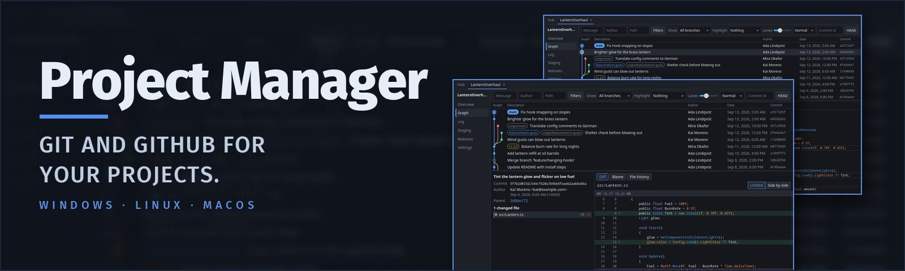
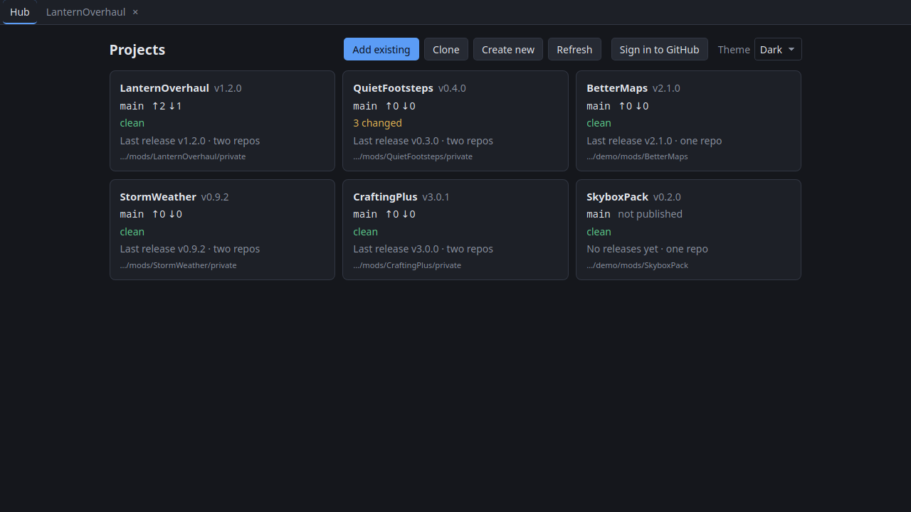
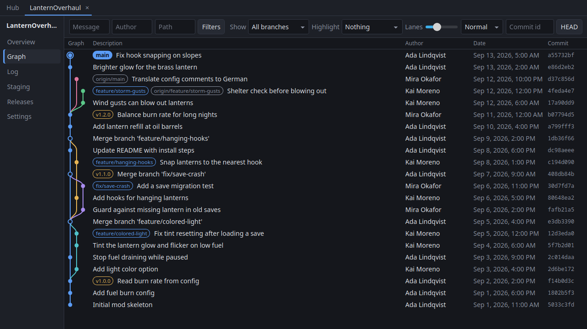
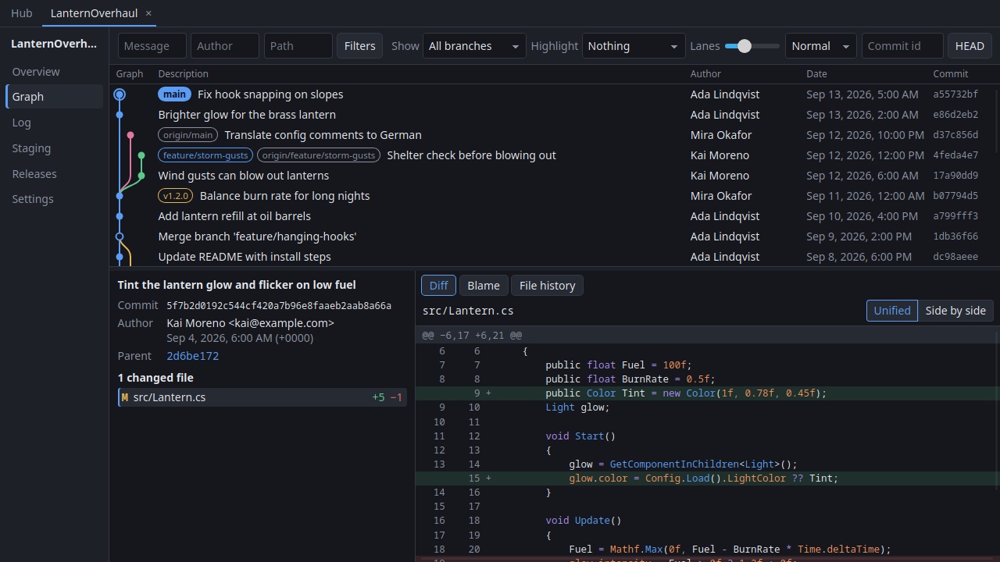
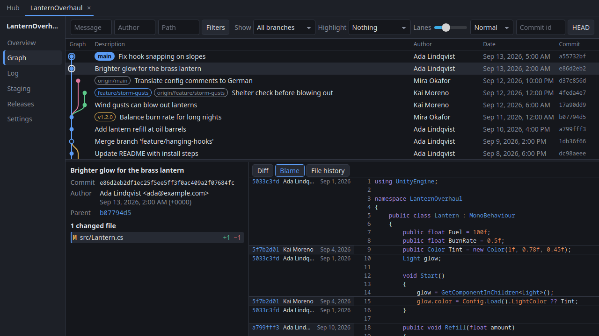
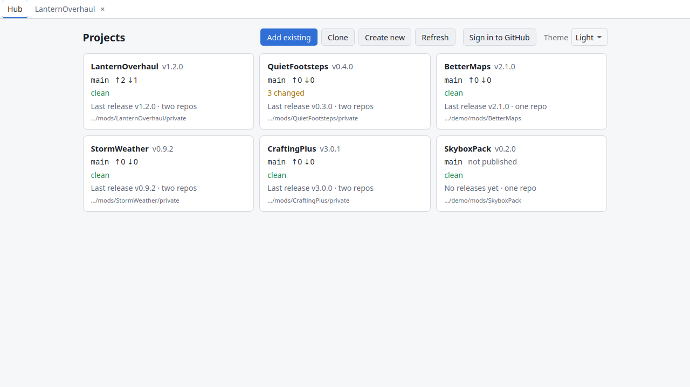
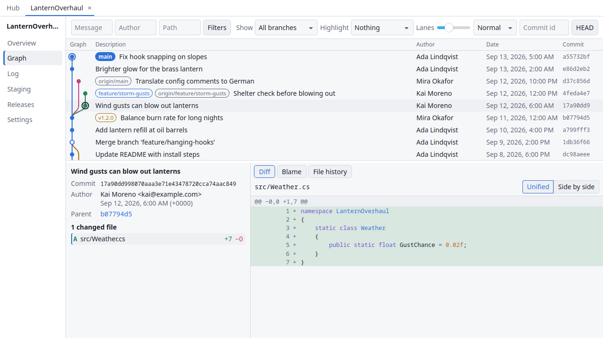

<p align="center">
  
</p>

<p align="center">
  <a href="https://github.com/glizzy5oblin/project-manager"></a>
  
  <a href="https://tauri.app"></a>
  <a href="https://www.rust-lang.org"></a>
  <a href="https://svelte.dev"></a>
</p>

<p align="center">
  <a href="https://github.com/glizzy5oblin/project-manager/commits"></a>
  <a href="https://github.com/glizzy5oblin/project-manager/issues"></a>
  <a href="https://github.com/glizzy5oblin/project-manager/stargazers"></a>
</p>

<h1 align="center">Project Manager</h1>

<p align="center"><b>One desktop app for all your projects: their git history, their private working repo and their public release repo.</b></p>

---

## About

Project Manager (project-manager) is a cross-platform git and GitHub manager for software projects, built with Rust, Tauri
and Svelte. It tracks many projects at once and manages each one's local and remote repositories, with a private
working side and a public release side. It is a work in progress.

## Features

- **Project hub.** Every project on one screen with its version, branch, commits ahead and behind, changed files and last
  release. Add an existing folder, clone a repository or create a new project.
- **Private and public repos.** A project can be one repository, or a private working repo paired with a public release
  repo.
- **Commit graph.** Every branch and tag in coloured lanes, with search by message, author or path, date and branch
  filters, branch highlighting and a jump to any commit id.
- **Commit details and diffs.** Unified or side-by-side diffs with syntax colours and changed words marked. Binary,
  oversized and renamed files get a short explanation instead.
- **Blame and file history** for any file in any commit.
- **Backups** before risky git actions, with restore. See [docs/backups.md](docs/backups.md).
- **Themes.** Built-in dark and light themes, plus your own as JSON. See [docs/themes.md](docs/themes.md).
- **GitHub sign-in** with a device code, the token kept in the system keychain, or reuse of a signed-in `gh`. See
  [docs/github.md](docs/github.md).

Staging, releases and uploads are planned and not built yet.

## Screenshots

<table>
  <tr>
    <td width="50%"><br><sub><b>Hub.</b> Every project with its branch, sync state and last release.</sub></td>
    <td width="50%"><br><sub><b>Graph.</b> Branches, merges and tags across the whole history.</sub></td>
  </tr>
  <tr>
    <td width="50%"><br><sub><b>Commit.</b> Details, changed files and a coloured diff.</sub></td>
    <td width="50%"><br><sub><b>Blame.</b> Who last changed each line, and in which commit.</sub></td>
  </tr>
  <tr>
    <td width="50%"><br><sub><b>Light theme.</b> The hub with the built-in light theme.</sub></td>
    <td width="50%"><br><sub><b>Light theme.</b> Diffs keep their syntax colours in every theme.</sub></td>
  </tr>
</table>

## Status

Early development. Working now: the project hub (add, clone and create projects, ahead/behind and change counts), backups before risky git actions with restore, themes, GitHub sign-in, and history (commit graph, log, search, commit details, diffs and blame). Staging, releases and uploads are not built yet.

## Requirements

- git 2.30 or newer
- Rust stable 1.90 or newer, with `rustfmt` and `clippy`
- Node.js 22 or newer with npm
- Tauri 2 system libraries. On Linux: webkit2gtk-4.1, gtk3, libsoup3, openssl and librsvg (see the Tauri prerequisites guide for your distribution). On Windows: WebView2 and the MSVC build tools. On macOS: Xcode command line tools.

Optional, for specific work:

- `git-lfs`: Git LFS projects and test fixtures
- `gh` (logged in): publishing releases with `make publish-release`
- `patchelf` and `dpkg`: local Linux AppImage and .deb builds
- `tauri-driver` and a WebKitWebDriver: end-to-end UI tests (not used yet)

## Setup

Everything for the app lives in `app/`.

```sh
cd app
npm install
npm run check          # type-check the frontend
npm run build          # build the frontend
cd src/desktop
cargo check            # first build takes a few minutes
```

Run the app in development:

```sh
cd app
npx tauri dev
```

## Code style

4 spaces for indentation everywhere. Makefile recipes use tabs, as `make` requires. The settings live in `.editorconfig`, `app/.prettierrc.json` and `app/src/desktop/rustfmt.toml`.

```sh
cd app
npx prettier --check .           # frontend and config formatting
cd src/desktop
cargo fmt --check                # Rust formatting
```

## Layout

```
.editorconfig              shared editor settings
Makefile                   build and dev targets (make help)
docs/                      documentation (.proj reference, backups, themes, GitHub sign-in)
app/
    src/
        ui/                Svelte + TypeScript frontend (index.html, main.ts, App.svelte, public/)
            lib/           API wrapper, stores, components; bindings/ is generated by ts-rs
        desktop/           Rust backend crate (Tauri 2)
            src/
                main.rs    entry point
                lib.rs     Tauri builder, module list
                commands.rs  Tauri commands and app state
                proj/      .proj schema, validation, comment-preserving edits
                git/       git detection, CLI write runner, gix reads, trust, URLs, watcher
                backup/    backups before dangerous actions, restore, retention
                projects/  hub registry, card summaries, create and clone, session and settings
                history/   commit graph, search, commit details, diffs and blame
                ipc/       error type for the frontend, background task manager
                theme/     built-in and JSON user themes
                github/    device-flow sign-in, keychain token, gh fallback, API client
                testing/   fixture repo generator (tests only)
            capabilities/  Tauri permission sets
            icons/         app icons
            tauri.conf.json
    build/                 all build output, git-ignored
        ui/                frontend bundle (Vite)
        rust/              Rust build (Cargo), including the app binary
    node_modules/          npm packages (npm always puts them beside package.json)
    package.json, vite.config.ts, tsconfig*.json, eslint.config.js, svelte.config.js
```

Each backend area is one folder under `app/src/desktop/src/` with a `mod.rs`; its unit tests sit in a `tests.rs` beside it.

Common commands from the repo root: `make lint`, `make test`, `make fmt`.

## Releases

Release builds are published on this repository's GitHub releases page.
